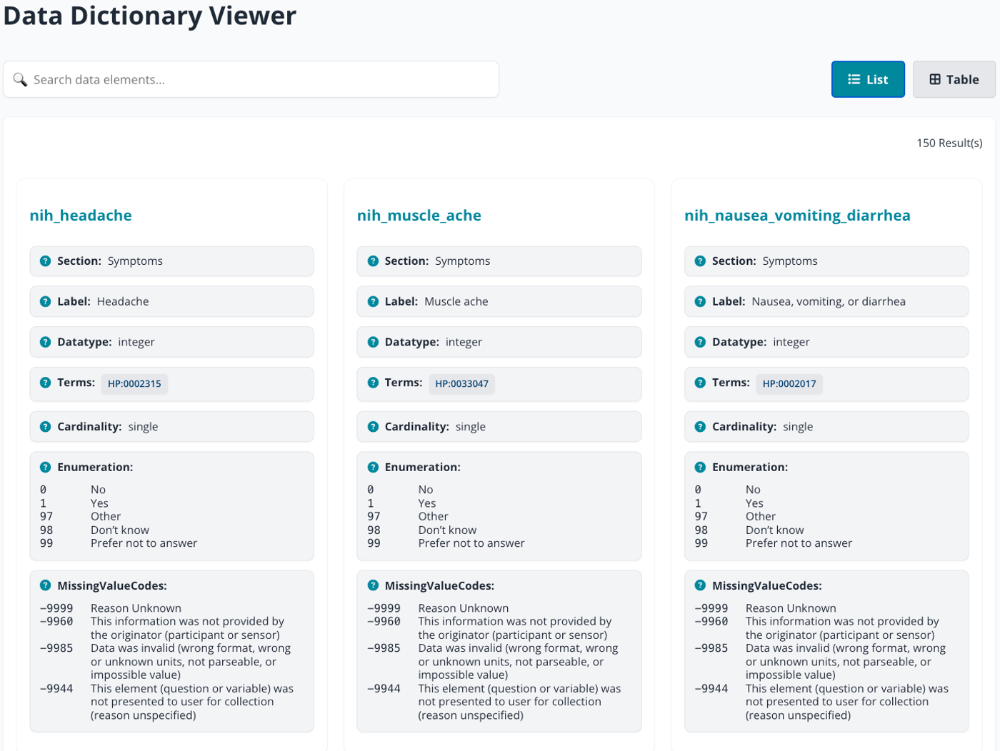
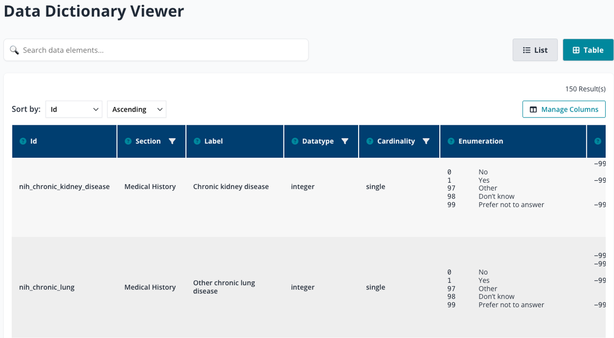
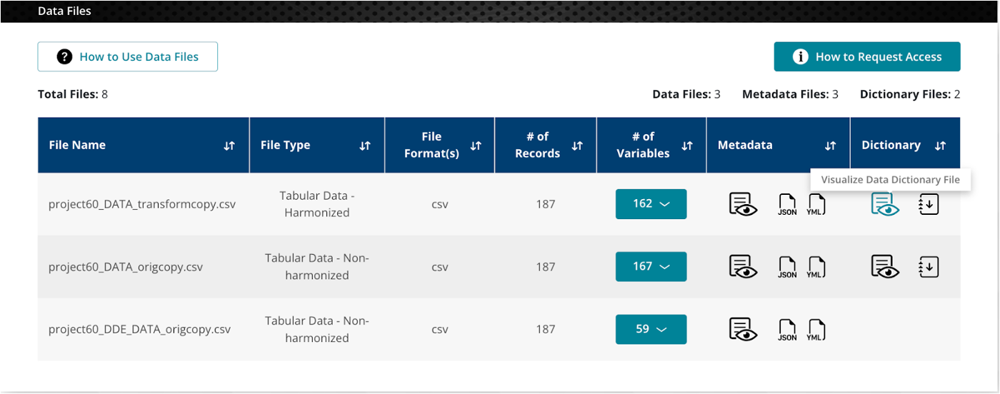
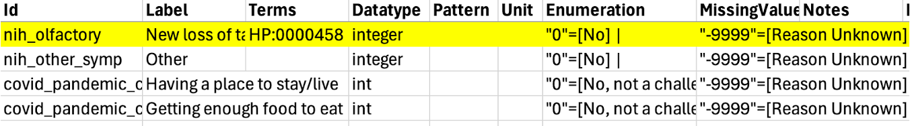
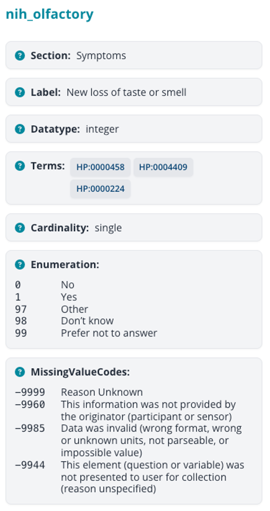

# Summary

A data dictionary is a document that precisely defines all data elements, or variables, within a dataset. Each element has a name and attributes describing its format, type, and permissible values. For example, a variable such as _heart_rate_ might be defined as an integer with typical values between 40 and 180, measured in beats per minute (bpm). For a given dataset, its data dictionary is a key piece of metadata that allows researchers and data analysts to interpret the dataset’s contents clearly.

Many researchers and institutions continue to rely on imprecisely defined, adhoc CSV files for data dictionaries, but even in Excel or Google Sheets important information such as enumerated values, ontology links, and metadata can remain hard to interpret. Because the data dictionary is the primary reference for understanding how every variable in a dataset is defined, any difficulty in reading or interpreting the data dictionary can have significant consequences. In large dictionaries, this lack of clarity not only slows analysis but also increases the risk of misinterpretation, incorrect use of variables, and errors in downstream research.

To improve usability, we developed DDViz, an interactive tool that transforms metadata from CSV files into a navigable interface, allowing users to quickly explore, search, and interpret variable definitions without downloading or manually parsing spreadsheets. It is implemented in React, distributed as both a React component and a framework-agnostic Web Component, and supports list and table views with searching, filtering, and sorting (_Figure 1_ and _Figure 2_). In addition, DDViz integrates Ontology support by linking Ontology terms to their authoritative definitions in Bioportal. Ontologies are structured vocabularies that formally define concepts and their relationships within a domain. BioPortal is a widely used online repository that hosts hundreds of biomedical ontologies, offering definitions, synonyms, and cross-references for standard terms [@bioportal]. This integration enables users to confirm definitions, examine permissible values, and explore related concepts.

The Data Dictionary Viewer was built based on the [RADx Data Dictionary Specification](https://github.com/bmir-radx/radx-data-dictionary-specification/blob/main/radx-data-dictionary-specification.md) [@specification], which is a general purpose, precisely specified, data dictionary format that defines the required columns and metadata standards for RADx studies. The viewer follows this specification to display key fields like Id, Label, Datatype, and Enumeration in a clear, web-based format. Our viewer was integrated into the NIH RADx Data Hub [@Martinez-Romero2025-yc], a former national resource for COVID-19 diagnostic data (_Figure 3_). It is now openly available on [GitHub](https://github.com/bmir-radx/data-dictionary-viewer-component) for reuse, with a [live demo](https://bmir-radx.github.io/data-dictionary-viewer-component/) provided online.

# Statement of need

Data dictionaries are essential for understanding the structure, definitions, and constraints of the elements within a dataset, yet they are often distributed as adhoc CSV files or spreadsheets that are in undocumented formats. While spreadsheets allow basic searching and filtering, their capabilities are limited. Important information, such as enumerated values for categorical variables, ontology mappings, or grouped metadata like datatype and units, often appears crammed into single cells, which are hard to read and interpret. These limitations slow analysis and increase the risk of error when processing large datasets.

This is where a dedicated data dictionary viewer such as DDViz can address the gap. By presenting metadata in a clear and searchable interface, researchers and data managers can rapidly evaluate whether a dataset is relevant, identify potential quality issues, and understand how variables align with accepted terminology.

For example, consider the variable _nih_olfactory_, which captures whether a participant reported a new loss of taste or smell. In _Figure 4_, taken from the raw CSV, the variable’s details are compressed into a single row: fields such as enumerations and missing value codes are buried in text,and ontology terms are shown only as their IDs. Although the information is technically there, it is difficult to scan, interpret, and use effectively.

By contrast, _Figure 5_ shows the same variable in DDViz, where metadata is organized into clear sections for labels, datatypes, enumerations, and missing values, making it much easier to interpret at a glance. When variables are associated with ontology terms, DDViz displays them as clickable links to those terms in the BioPortal ontology repository, enabling users to view authoritative definitions and to explore related concepts. These improvements make DDViz a far more effective tool for understanding complex variables than relying on raw CSV files alone.

Another important need that the viewer addresses is accessibility within web platforms. For most data dictionaries, users must download the CSV file and open it locally in Excel or another program, which interrupts the workflow and makes quick inspection difficult. DDViz acts as a renderer directly in the web interface, allowing users to open and explore variables instantly while remaining on the dataset’s webpage. This seamless integration saves time and makes metadata far more accessible at the point of use.

# Future work

A current limitation of DDViz is that it only accepts dictionaries formatted according to the structure defined in the [Data Dictionary Specification](https://github.com/bmir-radx/radx-data-dictionary-specification/blob/main/radx-data-dictionary-specification.md) [@specification], where certain columns are required. If a file does not follow this format, the viewer can still open it, but only in a simplified table view without the richer features. For future work, we aim to make the viewer more flexible so it can handle a wider variety of formats.

# Figures

{width=50%}

{width=50%}

{width=50%}

{width=50%}

{width=20%}

# References
